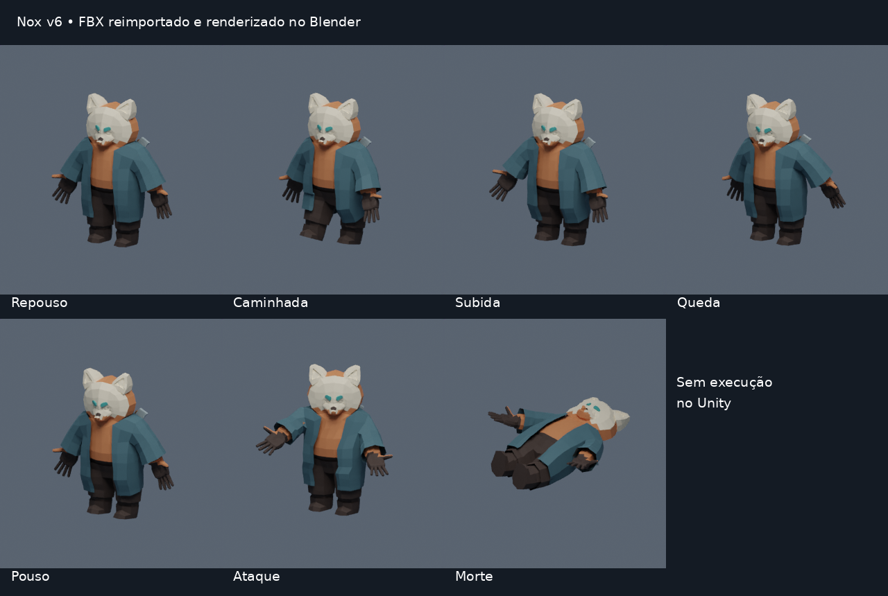

# Acabamento de jogabilidade e apresentação — v6

## Base e alcance

A revisão continua o PR #6, branch `feat/animacao-e-cenarios`, no commit `e70c6c2ca59ef397ff1a1e07197d4f18477d5d36`. Na conferência inicial, o PR estava aberto, sem merge; a branch de trabalho `feat/acabamento-jogabilidade` foi criada sobre sua árvore. As mudanças v5 foram reaproveitadas. Ao final da revisão, o PR #6 já havia sido integrado à main em `d593b5cb790e77deb515c6fd17cd15584334d2a4`, cuja árvore corresponde exatamente à base utilizada; a continuação foi direcionada à main.

Foram examinados scripts de execução e Editor, documentação de recuperação/física/qualidade, GDD e YAML das cenas e prefabs originais disponíveis localmente. A referência permanece Unity 2021.1.28f1 e C# 8, com o sistema de entrada e a renderização originais. Não foram acrescentados pacotes.

O repositório contém código, configurações, shader e personagem exportado. As cenas completas, os recursos dos pacotes e os áudios continuam no projeto recuperado do ZIP original. As ferramentas aplicam as mudanças nessa cópia completa; o repositório isolado não é uma distribuição jogável.

## Achados e correções

| Local | Evidência e impacto | Tratamento |
| --- | --- | --- |
| `PlayerScript.TrySlash` / `PlayerTwo.TrySlash` anteriores | `Input.GetKey(Mouse0)` criava golpes repetidos enquanto o botão permanecia pressionado; efeito e dano surgiam sem preparação | Clique inicial, fila curta, preparação, impacto único e recuperação em `NoxAttackCycle` / `NoxPlayerCombat` |
| `Boss.Update` / `BossScript.Update` anteriores | A área de dano permanecia ativada durante toda a proximidade; não havia antecipação ou recuperação | `NoxEnemyStrike` com fases e sinalização visual; contato do corpo deixa de equivaler a um ataque |
| `NoxChaseController` | Não havia verificação de visão nem tratamento explícito de caminho parcial | Consulta física de obstáculos e parada diante de caminho incompleto, mantendo intervalo de recálculo |
| `EnemyPatrol` | Amostragem de destino não comprovava um caminho completo | `CalculatePath` e `PathComplete`; percepção deixa de depender de uma comparação assimétrica de altura |
| `AimEnemy` | Disparo inicial imediato e repetição mesmo sem um alvo próximo | Preparação de 450 ms, verificação de alcance/visão e recuperação |
| `BulletEnemy` | Deslocamento por Transform em Update, sem teste do segmento percorrido | Passo físico, teste do trajeto, consumo ao atingir obstáculos e exclusão do emissor |
| `HUDAndSounds.SceneLoaded` | Menu principal e seleção de fases eram ativados juntos | Apenas o menu inicial abre ao entrar na cena de menu |
| Eventos dos botões | O YAML do menu contém ações em EventTrigger.PointerClick e callbacks repetidos; submissão por teclado não acompanha necessariamente esses eventos | Migração dos callbacks sem argumentos para Button.onClick, deduplicação por alvo/método e preservação da ordem e do estado dos listeners |
| `NoxCharacterVisual` | Parada global também bloqueava a apresentação de morte; salto terminava em pose neutra durante o voo | Estados próprios para subida, queda, pouso e morte; morte visual em tempo não escalado |
| `NoxSession.LoadNextScene` | A saída da última fase retornava imediatamente ao menu | Resultado de jornada concluída, com retorno pelo menu de resultado |
| `HUDAndSounds` | Sombras não eram persistidas; fontes podiam reiniciar com chamadas repetidas | Preferências de qualidade/intensidade e prevenção de reinício de uma fonte já em reprodução |
| `Lever` | Ocupação comunicada somente por vermelho/verde | Texto de estado, além da cor, preservando a lógica da placa e da porta |
| Plataformas/caixas v5 | Parte da aparência de cubo permanecia sob os detalhes | Malha visual talhada no lugar da superfície primitiva; colisores e área superior preservados |
| Atualização de cenas | O marcador v5 impediria aplicar uma nova preparação | Marcador, backup, prefab, Animator e recursos gerados v6 separados |

A inspeção demonstra as condições de código descritas; não comprova que todas tenham sido percebidas no teste manual anterior. A caminhada que parava após um passo foi relatada no projeto local, mas sua causa exata não foi reproduzida aqui.

## Decisões de jogabilidade

### Movimento e animação

O motor físico da v5 foi mantido, incluindo aceleração, frenagem, material sem atrito, transporte por plataforma, buffer de salto e tolerância de borda. A velocidade usada na apresentação continua sendo relativa ao apoio, em vez de depender apenas da tecla pressionada.

O FBX mantém a malha acadêmica de 1.994 vértices e o esqueleto de 52 ossos. Passou a conter sete ações: repouso, caminhada, subida, ataque, queda, pouso e morte. Repouso e caminhada repetem; as demais ações não. O Animator usa também velocidade vertical e estado de vida. `Alive` começa verdadeiro, evitando uma transição inicial indevida para morte.

A cadência considera a altura do collider e possui limite. É uma estimativa inicial; o contato visual dos pés e a correspondência exata entre passada e velocidade ainda exigem calibração no Unity. Não foi acrescentado IK de pés em execução.

A câmera recebeu antecipação horizontal curta baseada no deslocamento real, limitada a 0,8 unidade. A opção de reduzir movimentos remove essa antecipação. Não foram acrescentados tremores ou pausas globais de impacto.

### Combate

Cada golpe tem preparação de 120 ms, janela ativa de 180 ms e recuperação até completar 600 ms. Cada clique entra uma vez; a fila dura 200 ms. Cliques recentes próximos ao fim da recuperação podem encadear três estágios. Segurar o botão não gera ataques continuamente. A sequência reinicia após intervalo prolongado; pausa, morte, dano e interação com caixas interrompem a ação.

A direção do golpe é fixada na preparação. A orientação do personagem não muda durante preparação e impacto, mas o deslocamento permanece disponível. Quadros atrasados não produzem um impacto cuja janela já terminou. O terceiro golpe conserva o efeito viajante original e sua janela de voo de 1,5 s, com registro de alvos próprio.

Inimigos recebem preparação de 450 ms; chefes, 650 ms. A janela ativa é de 180 ms, com recuperação de 1,1 s. Sair do alcance ou perder a linha de visão durante a preparação cancela o golpe e leva à recuperação. O aviso usa círculo, crescimento e espessura, além da cor. A pausa oculta o aviso e bloqueia dano, preservando o relógio escalado da ação.

Os controladores de patrulha são desativados quando concorrem com a rota explícita ou o controlador de chefe. A preparação limita a vida do componente `Boss` a 30 quando a configuração anterior excedia esse valor. É uma alteração de balanceamento para evitar um encontro excessivamente longo; o equilíbrio final precisa de teste no jogo.

As animações e os áudios de inimigos dos pacotes originais não foram substituídos por assets novos. O aviso e a janela de dano são implementações próprias, sem alegação de um novo conjunto completo de animações inimigas.

### Interface, leitura e conclusão

Os menus recebem paleta escura com destaque suave, foco de seleção, navegação automática e textos de sistema em português. As áreas de clique independem dos rótulos; os controles gráficos aceitam ativação por teclado. Créditos e nomes próprios são preservados.

A interface de gameplay apresenta vida numérica, objetivo da fase e orientação contextual para caixas. O painel inteiro é ocultado durante pausa e resultados. Placas de pressão recebem texto de estado para complementar a cor.

As opções gráficas incluem **Realce ao receber dano** e **Reduzir movimentos de câmera e avisos**. São preferências locais sob `Nox.v1.Presentation.*`. Qualidade e intensidade das sombras usam `Nox.v1.Graphics.*`; as chaves de áudio e progresso anteriores permanecem válidas.

A morte bloqueia o mundo imediatamente, mas a animação usa tempo não escalado. O resultado aparece após 650 ms. A saída da última fase apresenta **Jornada concluída**, sem acrescentar mundos inexistentes ao GDD.

## Direção visual e atualização

A v6 mantém céu, atmosfera e paletas de ar e fogo da v5. Plataformas e caixas primitivas recebem malhas visuais próprias; as plataformas mantêm o topo retangular do apoio original. Rochas inferiores, frisos e vegetação de borda usam materiais compartilhados e não acrescentam colisores.

A ambientação v5 é preservada, mas fica desativada quando substituída pela v6. O novo conteúdo fica em `Assets/Art/Generated-v6/`. Personagens e modelos personalizados não recebem substituição indiscriminada. Os dados físicos e o NavMesh original não são reconstruídos automaticamente.

`NoxScenesPrepared-v6.txt`, `Backups/Preparacao-v6/`, `Nox-v6.controller` e `NoxPlayable-v6.prefab` distinguem esta revisão. As cópias e os assets antigos permanecem disponíveis. Falhas durante a preparação acionam a restauração das cenas; recursos novos já gerados podem permanecer no projeto para inspeção.

A referência de fase é AirPhase1.4. O gerador também contempla as demais fases existentes, mas não houve aprovação visual dessa referência nem propagação homologada no Unity: as mudanças são candidatas até o percurso real.

## Organização e desempenho

- Relógios de combate e cadência são regras puras testáveis, separados de física, animação e entrada.
- `NoxPlayerCombat` compartilha a integração dos dois controladores sem remover seus campos e métodos serializados.
- Consultas de visão e projéteis reutilizam buffers; recálculo de caminho permanece limitado.
- A sinalização usa um LineRenderer por ator e direções de círculo pré-calculadas, sem criar materiais por frame.
- O HUD verifica estado a 10 Hz e só altera o texto quando vida ou contexto mudam.
- Cenografia é gerada no Editor; materiais são compartilhados. Não foi introduzido pooling sem medição que o justifique.

Não houve medição com Profiler nem referência de hardware/resolução para FPS. Não há afirmação de desempenho estável.

## Evidência do asset

A prancha mostra amostras das ações do arquivo real. A câmera é ajustada ao personagem em cada pose; não é comparação de contato com o chão, captura de fase nem comprovação do Animator no Unity. Estrutura em [animacoes-v6.json](evidencias/animacoes-v6.json).

## Validação e limites

Os resultados de comandos ficam em [Qualidade](qualidade.md). Os testes automatizados do CI cobrem regras e arquivos; não executam gameplay. Compilação isolada usa referências oficiais 2021.1.28f1 e não substitui o Unity.

Menus acrescentados para validação no editor:

- **Verificar física em cena isolada:** sete verificações físicas anteriores.
- **Verificar animações e cenário:** estrutura dos clips e da ambientação atual.
- **Verificar visão e ações de interface:** 12 verificações isoladas de visão, migração de ação, deduplicação e validade de golpes.
- **Capturar Play atual:** solicita um PNG do frame real em `Logs/Capturas-v6/`.

Essas ações foram compiladas, mas não executadas no Unity neste ambiente. Capturas do jogo e uma build Windows nova continuam indisponíveis. Renderizações do Blender são identificadas como evidência offline do asset e não como gameplay.

### Aceite no projeto completo

1. Atualização com o Editor fechado e preparação v6, conferindo o backup.
2. Execução dos verificadores, revisão do Console e dos achados da auditoria.
3. AirPhase1.4: caminhada por mais de três ciclos, parada contra parede, plataforma parada/em movimento, saltos e puzzle das caixas.
4. Conferência de subida, queda, pouso, ataque e morte; correspondência dos pés, direção e alcance dos golpes.
5. Cliques isolados, botão segurado, combo, interrupção por dano e pausa durante cada fase da ação.
6. Inimigo atrás de parede, desvio durante a antecipação, recuperação e ausência de dano pelo simples contato do corpo.
7. Projéteis contra paredes finas e alvo atrás de obstáculos.
8. Menu, opções e resultados pelo mouse e pelo teclado; resoluções 1280×720 e 1920×1080 e leitura dos textos.
9. Preferências após reiniciar; realce desligado e movimento reduzido.
10. Percurso das outras fases, chefes, desbloqueio de fogo, morte, reinício, conclusão final e retorno ao menu.
11. Build Windows e repetição fora do editor antes de distribuição.

Checkpoints foram avaliados e adiados: restaurar somente a posição poderia separar o jogador do estado de caixas, placas, portas e plataformas. A retomada continua no início da fase, compatível com o progresso existente. Não foram acrescentados mundos, habilidades do GDD ainda não implementadas ou um salvamento parcial apresentado como completo.
