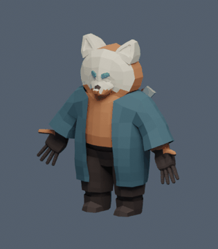

# Animação e ambientação — revisão v5

## Problema observado

A substituição do cubo pelo Nox funcionou no Play após a preparação das cenas. Durante a caminhada, o personagem dava o primeiro passo e depois parecia deslizar. Esse relato orientou a revisão; o defeito não foi reproduzido no Unity neste ambiente.

O código anterior reutilizava o prefab e o Animator já gerados sem revisá-los. A configuração de repetição dependia apenas do callback de importação do modelo. Essas condições permitiam manter um asset anterior sem garantir que os clips realmente tivessem repetição. A preparação v5 reimporta as configurações e confere `AnimationClip.isLooping`, além de gerar Animator e prefab com nomes novos. A causa exata da configuração no projeto local anterior não foi confirmada.

## Animações e movimento

- Malha acadêmica de 1.994 vértices e rig de 52 ossos preservados.
- Pose original avaliada antes de remover IK na cópia de trabalho. Os ciclos novos são exportados com curvas FK completas, sem depender das constraints do Blender no Unity.
- Caminhada de 24 quadros a 30 fps, com alternância das pernas, flexão dos joelhos e balanço dos braços. As rotações consideram a orientação de cada osso, evitando usar o mesmo eixo local em ossos com rolls distintos.
- Repouso com respiração discreta, em ciclo de 72 quadros. Os extremos dos ciclos coincidem.
- Repouso e caminhada repetem; salto e ataque terminam e mantêm a pose até a transição. Root motion continua desativado.
- Cadência acompanha a velocidade horizontal em relação à plataforma de apoio. A movimentação da plataforma não aciona passos por si só.
- Transição de ataque não reinicia o próprio estado a cada golpe. O dano continua no código de combate.
- Aceleração no chão de 48 unidades/s², frenagem de 64 e controle aéreo de 22. Velocidade máxima e altura máxima de salto foram mantidas.
- Buffer de salto de 120 ms e tolerância de 100 ms após deixar uma borda. Cada pedido é consumido uma única vez; pausa limpa os pedidos pendentes.
- Feedback de dano no material do personagem por 160 ms, sem alterar vida, proteção entre impactos ou materiais compartilhados.

O GIF mostra o asset reimportado no Blender, em oito amostras distribuídas por um ciclo de 0,8 s. Não representa o Animator, a física nem uma captura do Unity.

## Direção visual

A ambientação adota fantasia estilizada com superfícies facetadas. As fases de ar usam pedra azul acinzentada, pisos verde suave, detalhes dourados e céu frio. A fase de fogo usa pedra escura, tons ameixa, cobre e horizonte quente.

`NoxSceneArt` aplica no Editor:

- Céu próprio com gradiente de horizonte e disco de luz distante, sem imagens externas.
- Luz direcional, iluminação ambiente em três tons e névoa de profundidade.
- Silhuetas rochosas sob plataformas primitivas, frisos, cristais decorativos e cintas nas caixas.
- Ilhas e ruínas fora dos limites principais da fase; nuvens distantes nas fases de ar.

O processo usa materiais compartilhados e gera malhas no Editor. Não há busca de objetos ou geração de cenário a cada frame. A decoração de plataformas é limitada a 100 superfícies por cena; há 18 grupos de fundo por fase. As partes decorativas não recebem collider e acompanham as plataformas como filhos visuais. A área caminhável e o layout dos obstáculos permanecem no projeto original.

A seleção das superfícies considera malhas primitivas e hierarquia de plataformas. Personagem, inimigos identificados, VFX e modelos personalizados não recebem troca indiscriminada de materiais. A revisão não substitui todos os modelos de inimigos nem representa uma reconstrução integral das fases.

## Preparação e preservação

A revisão usa `NoxScenesPrepared-v5.txt` e backup `Backups/Preparacao-v5/`. Mesmo um projeto com marcador v4 recebe a nova preparação. O controlador e o prefab v4 continuam preservados; a v5 usa `Nox-v5.controller` e `NoxPlayable-v5.prefab`.

O atualizador preserva a cópia anterior de scripts, Editor, personagem e Art. As cenas passam por backup e restauração em caso de falha. Materiais e malhas novos ficam em `Assets/Art/Generated-v5/`. O processo mantém esses recursos gerados se já existirem; alterações artísticas posteriores exigem revisão explícita.

**Nox → Verificar animações e cenário** valida estruturalmente os clips, o shader, o Animator e a cenografia. Não substitui teste de jogabilidade.

## Verificações

A referência anterior passou por 87 verificações C#, oito testes de preparação, quatro de contratos e quatro de FBX. Na primeira execução local, os testes de preparação não encontraram `pwsh` no PATH; a execução com o PowerShell portátil no PATH passou antes das mudanças. Não foi identificado defeito anterior nessas suítes.

Resultados desta revisão e CI estão registrados em [Qualidade](qualidade.md). A compilação isolada usa as bibliotecas oficiais 2021.1.28f1 e trata avisos como erros. Os testes Python verificam também as curvas reais do FBX: extremos fechados, duração e movimento das duas pernas e dos braços durante todo o ciclo. O validador Blender amostra a posição avaliada dos dois pés e confirma fechamento e alternância.

## Limites e conferência no jogo

O Unity Editor, a renderização do shader, a preparação das cenas reais e o executável Windows desta revisão ainda não foram executados neste ambiente. A nova ambientação não possui captura homologada no Unity. O GIF é evidência offline do asset; não comprova ausência de deslizamento, clipping ou problemas de iluminação no jogo.

A conferência no Play inclui início e fim da caminhada, giros, colisão com paredes, plataformas móveis, salto curto após a borda, salto antecipado antes do pouso, dano, cura, ataque, pausa e sequência completa das fases. O percurso deve incluir o puzzle das caixas e os chefes, pois as mudanças de aceleração alteram a resposta dos controles.

Desempenho, visibilidade com diferentes qualidades gráficas, ajuste da névoa, contato visual dos pés, orientação do modelo e enquadramento do cenário ainda dependem do teste no Unity. Não foram adicionadas dependências, pacotes ou migração de versão do motor.

## Referências técnicas

- [ModelImporter.clipAnimations — Unity 2021.1](https://docs.unity3d.com/2021.1/Documentation/ScriptReference/ModelImporter-clipAnimations.html)
- [ModelImporterClipAnimation.loopTime — Unity 2021.1](https://docs.unity3d.com/2021.1/Documentation/ScriptReference/ModelImporterClipAnimation-loopTime.html)

A malha e a identidade do personagem continuam vinculadas à equipe acadêmica identificada no GDD. Os novos materiais, shader e elementos geométricos não incorporam recursos de outros jogos.
