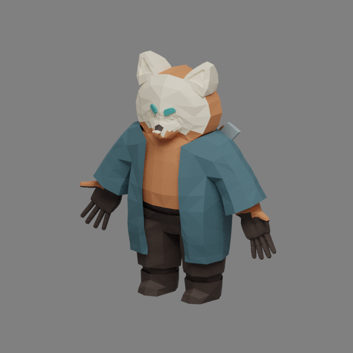

# Personagem original Nox

O arquivo `Nox.blend` foi localizado na pasta de animações de personagens do projeto acadêmico. O GDD versão 2.0, atualizado em 31/01/2023, descreve Nox como espírito de panda-vermelho, protagonista com manto, duas machadinhas e três pontos de vida. A malha e o esqueleto acadêmicos foram reaproveitados; não foram substituídos por um personagem de terceiros.

## Conteúdo recuperado e acrescentado

- Malha original `panda`, com 1.994 vértices, e esqueleto de 52 ossos.
- A revisão v4 recuperou as animações acadêmicas de repouso (150 quadros) e caminhada (70 quadros). A v5 substitui esses dois ciclos exportados por respiração de 72 quadros e caminhada FK de 24 quadros a 30 fps. O arquivo original continua intacto.
- Sete materiais de cores planas para pelo, rosto, olhos, vestuário e armas. O arquivo original não tinha materiais atribuídos à malha.
- Duas machadinhas nas costas, em quatro malhas simples novas, vinculadas ao osso do peito. São apresentação visual: o combate continua usando os golpes Slash existentes.
- Poses animadas de salto e ataque acrescentadas nesta revisão. São complementos de transição, não animações acadêmicas originais nem acabamento final de animação.



A imagem é uma renderização do asset no Blender. Não é captura do jogo no Unity. A paleta acrescentada é uma interpretação do panda-vermelho e do vestuário, sujeita à avaliação artística da equipe.

## Integração ao jogo

`Assets/Characters/Nox/Nox.fbx` contém malhas, rig, cores e quatro clips, sem referências de imagens ou dependências de texturas externas. O importador configura animação Generic e clips de repouso, caminhada, salto e ataque. O modelo não exige Blender instalado na máquina que abre o jogo.

**Nox → Preparar cenas recuperadas** aplica a revisão v5. Antes da regravação, as cenas recebem backup em `Backups/Preparacao-v5/`. A ferramenta gera `Nox-v5.controller` e `NoxPlayable-v5.prefab` dentro da pasta do personagem, vincula o visual aos jogadores e desativa somente o MeshRenderer do cubo. Rigidbody, collider, vida, câmera, mira e referências dos componentes permanecem no jogador.

O visual é ajustado ao collider existente, preservando as dimensões de gameplay desta etapa. Isso não afirma que o collider cúbico seja uma cápsula anatômica: substituir sua forma exige validar plataformas, impulso e caixas separadamente. O movimento físico permanece WASD, Espaço, E e mouse, conforme o controle já implementado.

`NoxCharacterVisual` suaviza a orientação do modelo e o parâmetro de caminhada, sem alterar a direção instantânea dos controles e da mira. Root motion fica desativado. O estado Grounded aciona a pose de salto; o gatilho Attack aciona o clip de ataque. O dano continua controlado pelo código e não por um evento visual de animação.

O controlador e o prefab da v4 são preservados. A v5 gera arquivos com nomes próprios e reimporta explicitamente as configurações de repetição do FBX, evitando reutilizar silenciosamente o Animator anterior. Os arquivos v5 já gerados são preservados em preparações posteriores.

## Atualização da pasta recuperada

1. Com o Unity fechado, executar `Atualizar-Nox.cmd` da nova branch e selecionar a pasta recuperada.
2. Reabrir o Unity e aguardar a importação do FBX e a compilação.
3. Executar **Nox → Preparar cenas recuperadas**. Não é necessário escolher o modelo manualmente.
4. Executar **Nox → Auditar cenas e referências**, abrir o menu original e iniciar o Play.
5. Conferir pés/chão, proporção, frente do personagem, repouso, caminhada, salto, ataque e giros sobre plataformas nas fases.

O atualizador passou a copiar também `Assets/Characters/Nox` e `Assets/Art`, preservando a pasta anterior no backup quando existir. Os arquivos .blend e o GDD originais no Drive não são alterados. Imagens de referência empacotadas no .blend não são redistribuídas.

## Reprodução da exportação

Blender 3.6.23 foi usado em modo background. O script verifica o hash da referência original antes de trabalhar sobre ela, calcula as ilhas da malha e exporta somente o personagem, rig e props. Exemplo:

```text
blender --background --python tools/exportar_nox_blender.py -- --source Nox.blend --output pasta-de-exportacao
```

O resultado é FBX binário 7400. O registro `personagem-nox.json` contém hashes, fontes, autoria acadêmica por contexto e distinção entre clips originais e complementos novos. O GDD identifica a equipe como João Vitor Vieira Cardoso, Lucas Alfredo Brandão e Mateus William Alves Torres Bento Magalhães. A localização em uma pasta individual não é usada para atribuir autoria exclusiva ao asset. Nenhuma licença geral sobre os materiais do jogo foi criada.

## Validação da integração v4 e limites históricos

- Arquivo exportado reimportado no Blender: cinco malhas, um rig com 52 ossos, quatro clips e sete materiais; nenhuma imagem externa importada.
- Testes FBX conferem hash, versão, clips, malhas, materiais, skin e ausência de imagens empacotadas. Não substituem o importador do Unity.
- Compilação isolada de 43 scripts de execução e seis de Editor com bibliotecas oficiais 2021.1.28f1 e avisos como erros: sem erros/avisos.
- 87 verificações de regras, oito testes de preparação/atualização, quatro de contratos e quatro de asset aprovados localmente. O [CI Windows 40611671152](https://github.com/Mateus1804/Nox/actions/runs/40611671152), sobre o código a591bde64dab49451018df176197471defdd9e32, aprovou as mesmas suítes sem testes pulados; status e logs do job 122564423309 foram conferidos. O script de reprodução também foi executado com sucesso usando os argumentos documentados.
- A validação registrada não inclui Unity Play, importação do FBX pelo Unity, geração dos assets Animator/Prefab no editor, build Windows ou percurso real. A cena fonte não é publicada; a substituição é aplicada na cópia completa pelo preparador. A substituição visual foi confirmada posteriormente no Play; animação e ambientação v5 possuem validação própria em [Animação e cenários](animacao-e-cenarios.md).

O GDD planeja fases e habilidades que a build original não implementa integralmente. Esta revisão não apresenta água, terra, escuridão ou sistema completo de habilidades como concluídos.
